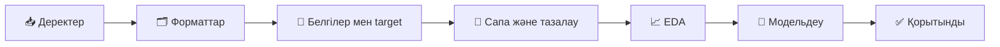

<div align="center">


<br/>


**Студенттің қорытынды бағасына қандай факторлар әсер етеді және оны алдын ала болжауға бола ма?**

[📌 Жоба](#-жоба-туралы) •
[📊 Деректер](#-деректер) •
[🚀 Іске қосу](#-іске-қосу) •
[🧪 Әдістер](#-әдістер) •
[⚠️ Шектеулер](#%EF%B8%8F-шектеулер)

</div>

---

## 📌 Жоба туралы

Деректер туралы ғылым (Data Science) пәні бойынша шағын жоба. Деректерді жүктеуден бастап соңғы қорытындыға дейінгі толық жол өтіледі.



| № | Кезең | Не істеледі |
|:-:|---|---|
| 1 | **Деректер көзі және форматтар** | CSV, Excel, JSON форматтарында сақтау және салыстыру |
| 2 | **Белгілер мен мақсат** | `G3` бағасын (0–20) мақсатты айнымалы ретінде таңдау |
| 3 | **Деректер сапасы** | Бос мән, қайталану, аномалияларды іздеу және тазалау |
| 4 | **EDA** | Таралулар, корреляциялар, топтарды салыстыру (6 график) |
| 5 | **Модельдеу** | Сызықтық регрессия және кездейсоқ орман |
| 6 | **Қорытынды** | Маңызды факторлар, шектеулер, келесі қадамдар |

## 📊 Деректер

<table>
<tr><td><b>📚 Көзі</b></td><td><a href="https://archive.ics.uci.edu/dataset/320/student+performance">UCI Machine Learning Repository — Student Performance</a></td></tr>
<tr><td><b>✍️ Авторлары</b></td><td>P. Cortez, A. Silva (2008)</td></tr>
<tr><td><b>📄 Файл</b></td><td><code>student-mat.csv</code> (математика пәні), бөлгіш <code>;</code></td></tr>
<tr><td><b>📏 Өлшемі</b></td><td>395 студент · 33 баған</td></tr>
<tr><td><b>🎯 Мақсат</b></td><td><code>G3</code> — қорытынды баға (0–20)</td></tr>
</table>

<details>
<summary><b>🔎 Белгілер топтары</b></summary>

<br/>

| Топ | Белгілер |
|---|---|
| 👪 Отбасы | `Medu`, `Fedu`, `Mjob`, `Fjob`, `famrel`, `famsize`, `Pstatus` |
| 📖 Оқу әдеті | `studytime`, `failures`, `absences`, `paid`, `schoolsup`, `higher` |
| 🎉 Өмір салты | `goout`, `freetime`, `Dalc`, `Walc`, `romantic`, `health` |
| 🏫 Мектеп және орта | `school`, `address`, `internet`, `traveltime`, `reason` |
| 📝 Бағалар | `G1`, `G2` (1-, 2-тоқсан), `G3` (қорытынды) |

</details>

## 🚀 Іске қосу

```bash
# 1. Репозиторийді көшіру
git clone https://github.com/<қолданушы-аты>/<репозиторий-аты>.git
cd <репозиторий-аты>

# 2. Кітапханаларды орнату
pip install -r requirements.txt

# 3. Деректер: student-mat.csv файлын жоба қалтасына салыңыз
#    (файл болмаса, ноутбук оны UCI сайтынан өзі жүктеуге тырысады)

# 4. Ноутбукті ашу
jupyter notebook student_performance_analysis.ipynb
```

## 🗂 Жоба құрылымы

```text
.
├── 📓 student_performance_analysis.ipynb   # негізгі ноутбук
├── 🖼  banner.svg                           # README баннері
├── 📄 student-mat.csv                      # деректер (UCI)
├── 📦 requirements.txt                     # тәуелділіктер
├── 📊 figures/                             # графиктер (автоматты)
├── 🗃  data_formats/                        # CSV / XLSX / JSON (автоматты)
└── 🧾 results.json                         # модель метрикалары (автоматты)
```

## 🧪 Әдістер

<table>
<tr>
<td width="50%" valign="top">

### 🧹 Тазалау
- қайталанған жолдарды алу
- бос мәндерді толтыру
- `absences` аномалияларын IQR шегімен кесу (флагпен)
- `G3 = 0` жағдайларын өшірмей белгілеу
- `yes/no` → `0/1`

</td>
<td width="50%" valign="top">

### 🤖 Модельдеу
- **Базалық болжам** (орташа) — салыстыру үшін
- **Сызықтық регрессия**
- **Кездейсоқ орман**
- Бағалау: train/test (80/20) + 5-блокты кросс-валидация
- Метрикалар: **MAE · RMSE · R²**

</td>
</tr>
</table>

> 💡 **Екі сценарий.** **A)** барлық белгілермен; **B)** `G1`, `G2` бағаларынсыз — әлі бағалар жоқ кездегі «ерте ескерту» жағдайы.

## ⚠️ Шектеулер

- Үлгі шағын (~395 студент), екі мектептен ғана
- Корреляция себеп-салдарды дәлелдемейді
- `G3 = 0` жағдайлары (емтиханға қатыспау) болжамды қиындатады

## 📚 Әдебиет

1. Provost F., Fawcett T. *Data Science for Business*. O'Reilly, 2013.
2. VanderPlas J. *Python Data Science Handbook*. O'Reilly, 2016.
3. pandas құжаттамасы: <https://pandas.pydata.org/docs/>
4. Cortez P., Silva A. *Using Data Mining to Predict Secondary School Student Performance*, 2008.

---

<div align="center">

👤 **<Аты-жөніңіз>** · <университет / топ> · 2026

⭐ Жоба ұнаса, репозиторийге жұлдызша қоюды ұмытпаңыз!

</div>
